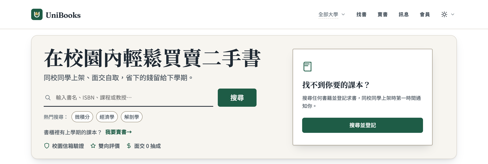
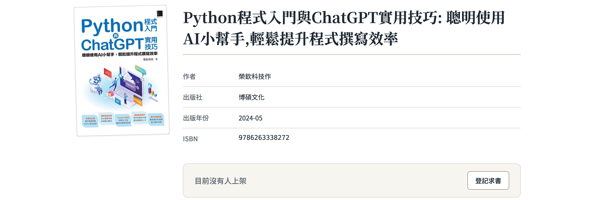

  

  <h1 class="title-zh">讓閒置課本 找到<em>下一位同學</em></h1>
  
校內同學<b>面交 0 抽成</b>　•　掃描就能賣書、找書、送書

  
學期結束，書櫃裡的課本要丟掉還是賣掉？

  
賣給學弟妹吧！UniBooks 是致理人，自己人開發的二手教科書交易網站

  

    <h2>二手書為什麼難賣？</h2>
    <ul class="items">
      <li>
1

<b>貼文一下就沉了</b>FB 社團、Dcard 貼文很快被洗掉。
</li>
      <li>
2

<b>買家找不到</b>課程、版本不同，同學找不到你手上的那本。
</li>
      <li>
3

<b>手續費吃利潤</b>一本才一兩百元，平台費用吃掉不少。
</li>
    </ul>
  

  

    <h2>UniBooks 怎麼解？</h2>
    <ul class="items">
      <li>
1

<b>以書為單位</b>同一本書的賣家集中一頁，比價格、比書況。
</li>
      <li>
2

<b>用課程、教授搜尋</b>輸入老師姓名，就找到指定用書。
</li>
      <li>
3

<b>求書通知</b>找不到就登記，有人上架立刻通知你。
</li>
    </ul>
  

  <h2>實際畫面</h2>
  

    <figure><figcaption>首頁：書名、課程、教授都能搜</figcaption></figure>
    <figure><figcaption>書籍頁：沒人上架可「登記求書」</figcaption></figure>
  

  

1
<b>掃書背條碼</b>手機對準 ISBN

  

2
<b>書目自動帶入</b>書名、作者、封面一次填好

  

3
<b>選書況、定價格</b>10 秒完成上架

  

0 抽成
同校面交 賣多少拿多少

  

0 元贈書
用不到的書 直接送給學弟妹

  

在校生驗證
學校信箱登入 交易對象都是同學

  

  

    <b>現在掃描，開始使用 unibooks.app</b>
    <ol class="go">
      <li><i>1</i>用學校信箱（.edu.tw）登入</li>
      <li><i>2</i>賣書：掃書背條碼、選書況、定價格</li>
      <li><i>3</i>買書：搜尋書名、ISBN、課程或教授</li>
    </ol>
    UniBooks 是致理資管系同學自己做、為同學解決自己的問題。
  

