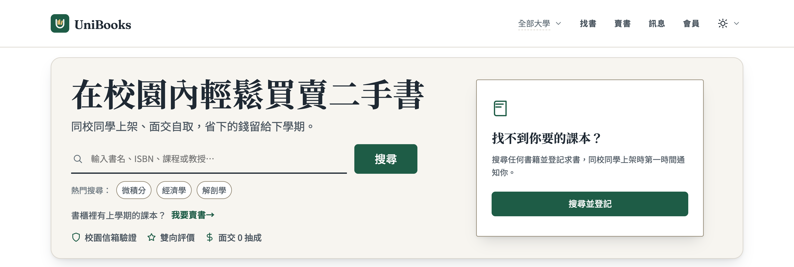
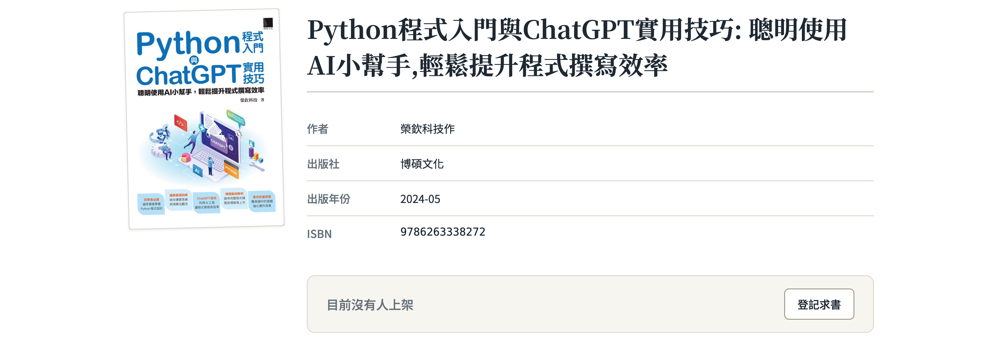

  

  <h1 class="title-zh">讓閒置課本 找到<em>下一位同學</em></h1>
  
UniBooks: Campus Used Textbooks, Matched by ISBN and Handed Over in Person

  
周恭煥

  
CycleUni 團隊｜致理科技大學 資訊管理系

  <h2>摘要 Abstract</h2>
  
UniBooks 是為<b>台灣大專學生</b>打造的二手教科書媒合平台。學生原本靠 FB 社團與 Dcard 找書，貼文零散、很快被洗掉，也無法依課程搜尋。UniBooks 以 <b>ISBN 為單位</b>，把同一本書的所有賣家集中在一頁，並提供<b>書名、課程、教授搜尋</b>、求書通知與 0 元贈書；以 .edu.tw 信箱驗證在校生，<b>同校面交 0 抽成</b>。前端、REST API 與即時聊天全部跑在<b>單一 Cloudflare Worker</b>，已於 unibooks.app 正式上線。

  

    <h2>為什麼二手書難賣？</h2>
    <ul class="items">
      <li>
1

<b>貼文被洗掉</b>FB、Dcard 貼文格式不一，也沒有版本欄位，一下就沉了。
</li>
      <li>
2

<b>買家找不到</b>課程、版本不同，同學找不到你手上的那一本。
</li>
      <li>
3

<b>手續費吃利潤</b>一本才一兩百元，拍賣平台的費用吃掉不少。
</li>
      <li>
4

<b>陌生人交易沒保障</b>不知道對方是不是真的在校生。
</li>
    </ul>
  

  

    <h2>UniBooks 怎麼解？</h2>
    <ul class="items">
      <li>
1

<b>以書為單位</b>輸入或掃描 ISBN 自動帶入書目，同一本書的賣家集中一頁，比價比書況。
</li>
      <li>
2

<b>課程與教授搜尋</b>賣家上架時填課程與教授，買家輸入教授姓名就找到指定用書。
</li>
      <li>
3

<b>求書通知</b>找不到就登記求書，有人上架立刻通知，頁面顯示「N 人在等」。
</li>
      <li>
4

<b>0 元贈書・在校生驗證</b>用不到的書直接送人；學校信箱驗證，同校面交 0 抽成。
</li>
    </ul>
  

  <h2>實際畫面 Demo</h2>
  

    <figure><figcaption>圖 1　首頁：書名、ISBN、課程、教授都能搜</figcaption></figure>
    <figure class="fig-bottom"><figcaption>圖 2　書籍頁：以 ISBN 為單位；暫時沒人上架時可「登記求書」，有人上架就通知</figcaption></figure>
  

  

    

1
<b>掃書背條碼</b>手機鏡頭對準 ISBN

    

2
<b>書目自動帶入</b>書名、作者、封面一次填好

    

3
<b>選書況、定價格</b>也可以標 0 元直接送人

  

  

    <h2>技術架構 Technology</h2>
    

      

        
unibooks.app　＝　單一 Cloudflare Worker（前端為 Angular 22 PWA）

        

          
<b>Static Assets</b><small>前端靜態檔 不經 Worker・不計請求</small>

          
<b>Hono REST API</b><small>/api/v1/* OG meta 注入（連結預覽）</small>

          
<b>Chat</b><small>/api/chat/*　WebSocket Durable Objects</small>

        

      

      
▼

      

        
<b>D1</b><small>帳號・書・刊登・訂單 廣告另庫</small>

        
<b>R2</b><small>刊登照片・聊天圖片</small>

        
<b>KV</b><small>快取・書目查詢結果</small>

        
<b>Durable Objects</b><small>ChatRoom・UserHub OrderLock・RateLimiter</small>

        
<b>Queues</b><small>Mailjet 信件・FCM 推播</small>

        
<b>Service Binding</b><small>國圖 ISBN 爬蟲 Worker</small>

      

    

    <figcaption style="text-align:center;margin-top:4mm;">圖 3　系統架構：前端、API、即時聊天同屬一個 Worker</figcaption>
  

  

    <h2>設計重點</h2>
    <ul class="dec">
      <li><b>即時聊天。</b>用 Durable Objects 處理對話與 WebSocket，訊息存在內建 SQLite；UserHub 另管未讀數與通知連線。</li>
      <li><b>狀態轉換靠鎖。</b>OrderLock 避免同一筆訂單被同時改狀態，RateLimiter 以原子計數限流。</li>
      <li><b>書目雙來源＋快取。</b>國圖 ISBN 由獨立的 Worker 爬蟲（Service Binding 呼叫），搭配 Google Books，查詢結果存 KV，掃條碼即可上架。</li>
      <li><b>廣告資料獨立。</b>廣告主與廣告使用獨立的 D1；曝光與點擊採用 Analytics Engine。</li>
    </ul>
  

  

  

    <b>掃描 QR code，開始使用 unibooks.app</b>
    <ol class="go">
      <li><i>1</i>用學校信箱（.edu.tw）登入</li>
      <li><i>2</i>賣書：掃書背條碼，書目自動帶入，選書況、定價格（0 元也能送人）</li>
      <li><i>3</i>買書：搜尋書名、ISBN、課程或教授，找不到就登記求書</li>
    </ol>
    UniBooks 是致理資管系同學自己做、為同學解決自己的問題。
  

